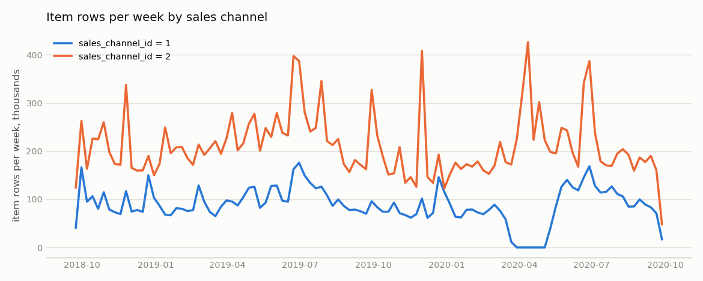
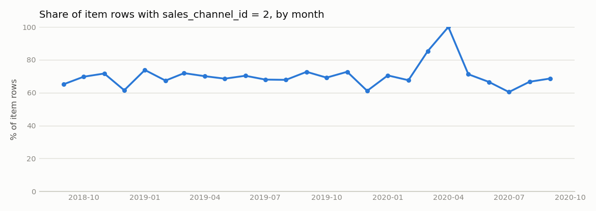
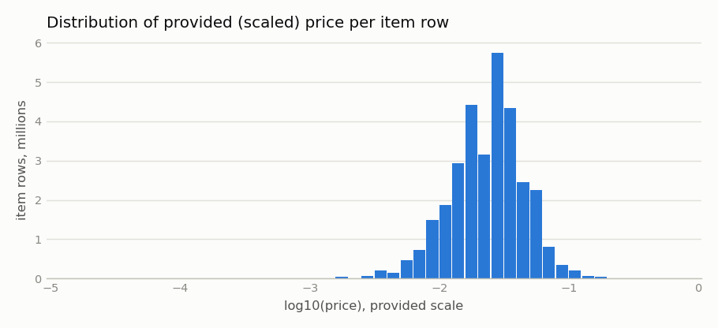

# Качество данных

Сгенерировано `hmrp report` из `reports/data/source_audit.json` и `dataset_summary.json` набора `smoke_dfa33f484c`. Исправлений значений не выполнялось; правила ниже.

## Источник и загрузка

| Файл | load_id | Прочитано строк | Загружено | Отклонено (структура / тип) | Байт | SHA-256 |
|---|---|---|---|---|---|---|
| transactions_train.csv | 1 | 31 788 324 | 31 788 324 | 0 / 0 | 3 488 002 253 | `fff5e3b35c1b2601…` |
| customers.csv | 2 | 1 371 980 | 1 371 980 | 0 / 0 | 207 135 859 | `abf3450c37ee1c16…` |
| articles.csv | 3 | 105 542 | 105 542 | 0 / 0 | 36 127 865 | `25f21882053517f7…` |

Причины отклонения: нет отклонённых строк.

## Транзакции

| Показатель | Значение |
|---|---|
| Строк | 31 788 324 |
| Клиентов | 1 362 281 |
| Товаров | 104 547 |
| Дат с записями | 734 |
| Диапазон | 2018-09-20 … 2020-09-22 |
| Пропущенные календарные даты | нет |
| Сумма price (предоставленная шкала) | 884645.9740 |

### Цена (предоставленная/масштабированная шкала)

Шкала price в источнике не документирована как валюта; суммы не интерпретируются как выручка.

| min | p1 | p50 | p99 | max | mean | нулевых | отрицательных | нечисловых/inf |
|---|---|---|---|---|---|---|---|---|
| 0.000017 | 0.003576 | 0.025407 | 0.100220 | 0.591525 | 0.027829 | 0 | 0 | 0 |

### Полностью совпадающие строки

Строки с одинаковыми (t_dat, customer_id, article_id, price, sales_channel_id) сохранены: в источнике нет order_id и количества, повтор может означать несколько единиц товара.

| Кратность | Групп | Строк |
|---|---|---|
| 1 | 26 269 511 | 26 269 511 |
| 2 | 2 285 073 | 4 570 146 |
| 3 | 177 237 | 531 711 |
| 4 | 55 412 | 221 648 |
| 5 | 9 259 | 46 295 |
| 6 | 8 181 | 49 086 |
| 7 | 1 733 | 12 131 |
| 8 | 2 132 | 17 056 |

Строк в группах с кратностью > 1: 5 518 813; сверх первой строки группы: 2 974 905.

### Каналы продаж

| sales_channel_id | Строк | Доля |
|---|---|---|
| 1 | 9 408 462 | 29.60% |
| 2 | 22 379 862 | 70.40% |

Значение кодов каналов источником не раскрыто; в признаках используется только доля `sales_channel_id = 2`.

## Справочники и покрытие ключей

| Проверка | Результат |
|---|---|
| customers.csv: строк / уникальных customer_id / пустых | 1 371 980 / 1 371 980 / 0 |
| articles.csv: строк / уникальных article_id / пустых | 105 542 / 105 542 / 0 |
| Клиенты транзакций без строки в customers.csv | 0 |
| Товары транзакций без строки в articles.csv | 0 |
| Пропуски customers.csv: FN / Active / age / club_member_status / fashion_news_frequency | 895 050 / 907 576 / 15 861 / 6 062 / 16 009 |

Поля customers.csv — снимок текущего состояния без истории; в модель не подаются.

## Проверки JOIN (фактические, на H&M)

| JOIN | Ключ справочника уникален | Строк до | Строк после | Сумма price до | после | Без пары | Статус |
|---|---|---|---|---|---|---|---|
| transactions_to_articles | да | 31 788 324 | 31 788 324 | 884645.9740 | 884645.9740 | 0 | passed |
| transactions_to_customers | да | 31 788 324 | 31 788 324 | 884645.9740 | 884645.9740 | 0 | passed |

Демонстрация JOIN-ловушки на искусственных данных (не находка в H&M): [`data/join_trap_demo.json`](data/join_trap_demo.json).

## Набор `smoke_dfa33f484c`: сверка слоёв

| Слой | Строк (товарных записей) | Сумма price |
|---|---|---|
| raw.transactions (клиенты набора) | 318 040 | 8842.202915 |
| derived.customer_day (sum n_rows / sum spend) | 318 040 | 8842.202915 |

Строки customer_day: 90 334; клиентов с покупками: 13 831. Совпадение строк: True, сумм (rel 1e-9): True. Метки с незрелым окном: 0; нарушения границ истории: 0.

Покрытие календаря: 734 дат из 734; дни с объёмом < 0.5 скользящей медианы за 28 дней: 3 (2018-12-25, 2019-12-25, 2020-01-01). Последний день: 32 866 строк, отношение к медиане 0.85. Решение: max(t_dat) + 1 day: no missing dates and the last day is not truncated.

Покупательские дни на клиента за весь период: квантили q0.25=1, q0.5=3, q0.75=8, q0.9=17, q0.99=45; доля клиентов с ≥2 днями: 66.87%.

EXPLAIN ANALYZE тяжёлых запросов (выполнены в рамках сборки): [`explain_customer_day_insert.txt`](data/smoke_dfa33f484c/explain_customer_day_insert.txt), [`explain_snapshot_insert_2019-01-02.txt`](data/smoke_dfa33f484c/explain_snapshot_insert_2019-01-02.txt)

