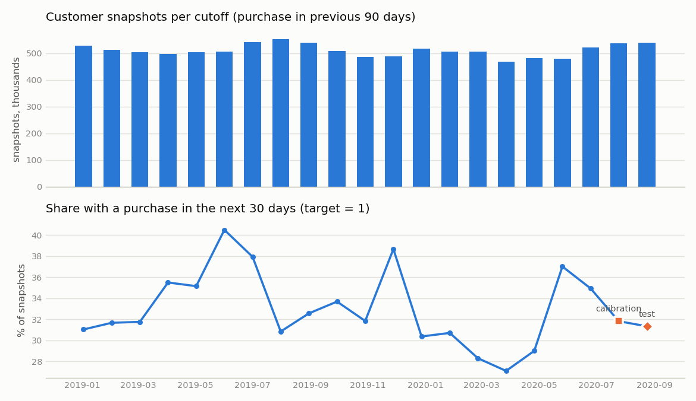
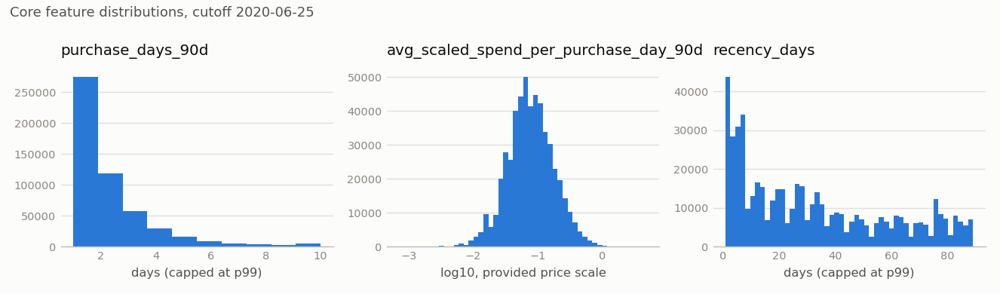
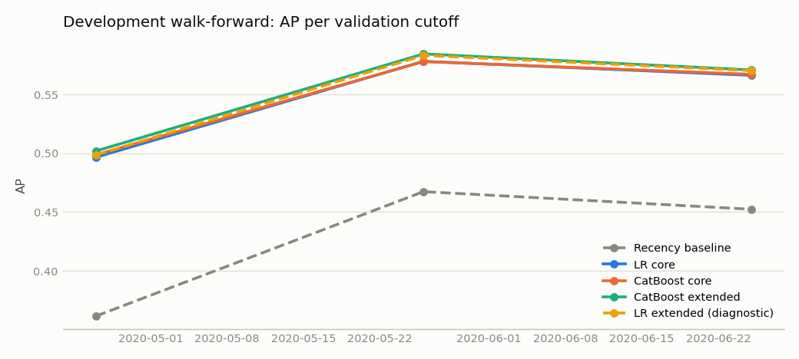
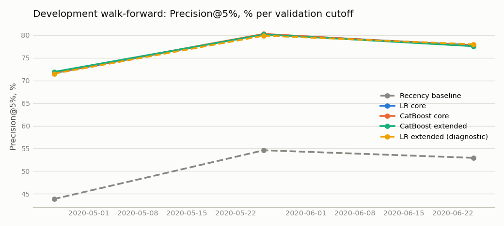
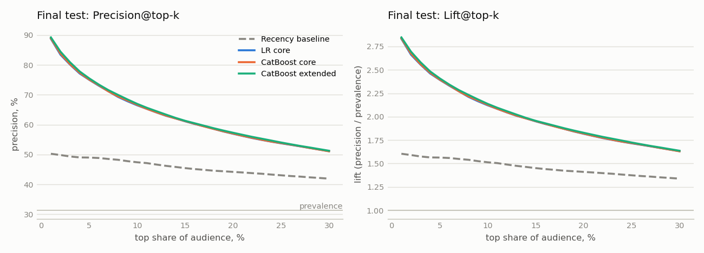
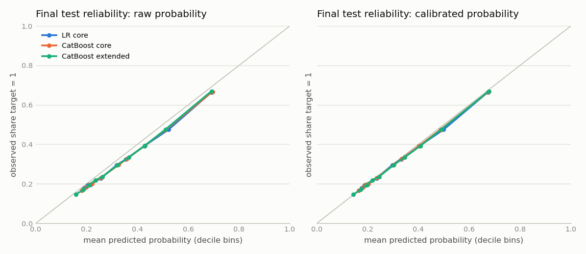
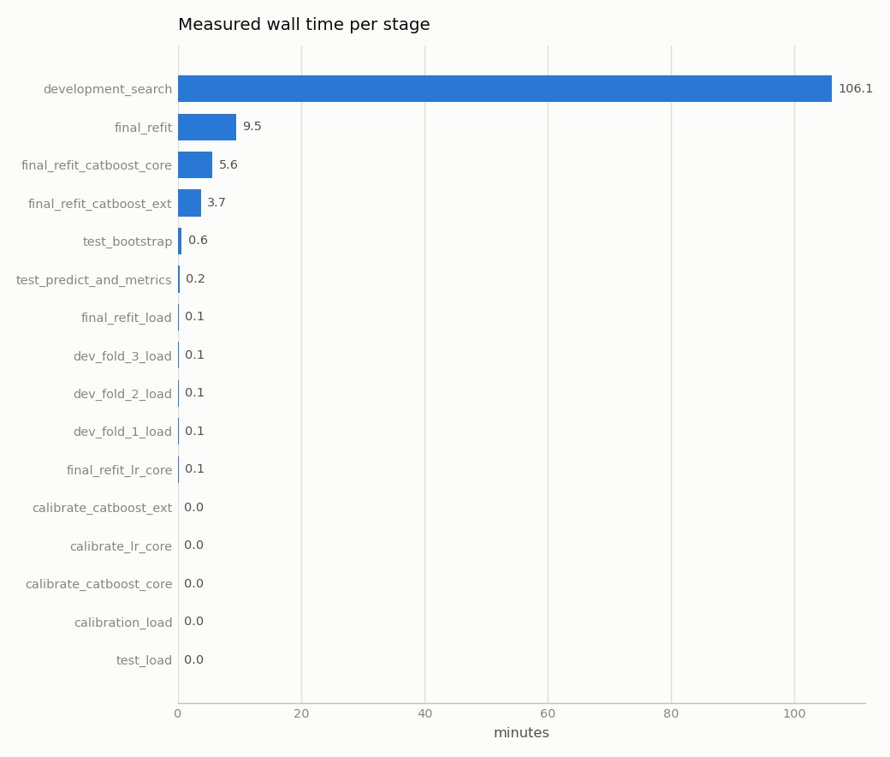

# Результаты: режим `full`, run `full-20261031T151306Z-b6b9e1`

Сгенерировано командой `hmrp report` из артефактов run (2026-10-31T17:12:36Z). Набор данных `full_6114b4ad79`. Машинно-читаемые файлы: [`runs/full-20261031T151306Z-b6b9e1/`](runs/full-20261031T151306Z-b6b9e1/).

## Данные и когорта

| Величина | Значение |
|---|---|
| Товарные записи transactions_train.csv | 31 788 324 |
| Уникальные customer_id в транзакциях | 1 362 281 |
| Уникальные article_id в транзакциях | 104 547 |
| Диапазон t_dat | 2018-09-20 … 2020-09-22 (734 дат) |
| Строки customers.csv / articles.csv | 1 371 980 / 105 542 |
| Клиенты в наборе `full_6114b4ad79` (доля 1.0) | 1 371 980 |
| Клиенты с ≥1 покупательским днём / с ≥2 | 1 362 281 / 914 308 |
| Строки customer_day | 9 080 179 |
| Клиентские срезы (все допустимые cutoff) | 10 719 039 |
| observation_end_exclusive | 2020-09-23 (max(t_dat) + 1 day: no missing dates and the last day is not truncated) |

## Временные границы

| Этап | Train-срезы (cutoff) | N train | Доля target=1 train | Оценочный срез и окна | N оценки | Доля target=1 |
|---|---|---|---|---|---|---|
| dev fold 1 | 2019-01-02 … 2020-03-27 (16 срезов) | 8 160 990 | 32.99% | 2020-04-26 → [2020-04-26, 2020-05-26) | 482 273 | 29.01% |
| dev fold 2 | 2019-01-02 … 2020-04-26 (17 срезов) | 8 643 263 | 32.76% | 2020-05-26 → [2020-05-26, 2020-06-25) | 478 991 | 37.01% |
| dev fold 3 | 2019-01-02 … 2020-05-26 (18 срезов) | 9 122 254 | 32.99% | 2020-06-25 → [2020-06-25, 2020-07-25) | 520 860 | 34.93% |
| calibration | refit: 2019-01-02 … 2020-06-25 (19 срезов) | 9 643 114 | 33.09% | 2020-07-25 → [2020-07-25, 2020-08-24); история [2020-04-26, 2020-07-25) | 536 041 | 31.82% |
| final test | те же модели | — | — | 2020-08-24 → [2020-08-24, 2020-09-23); история [2020-05-26, 2020-08-24) | 539 884 | 31.34% |

## Development walk-forward (validation)

Для каждой модели показана конфигурация с лучшим mean AP; все конфигурации — в [`dev_results.csv`](runs/full-20261031T151306Z-b6b9e1/dev_results.csv).

| Модель | Роль | Конфигурация | AP по fold 1/2/3 | mean AP | std AP | mean ROC-AUC | mean Precision@5% |
|---|---|---|---|---|---|---|---|
| recency_baseline | baseline | score=-recency_days | 0.3615 / 0.4674 / 0.4524 | 0.4271 | 0.0573 | 0.6107 | 50.45% |
| lr_core | кандидат | C=0.01 | 0.4966 / 0.5782 / 0.5663 | 0.5470 | 0.0441 | 0.6742 | 76.55% |
| catboost_core | кандидат | d6_lr0.05_l2_10 | 0.4987 / 0.5780 / 0.5672 | 0.5479 | 0.0430 | 0.6765 | 76.58% |
| catboost_ext | кандидат | d8_lr0.10_l2_10 | 0.5019 / 0.5845 / 0.5708 | 0.5524 | 0.0443 | 0.6859 | 76.55% |
| lr_ext | диагностика | C=1 | 0.4986 / 0.5832 / 0.5702 | 0.5507 | 0.0456 | 0.6818 | 76.47% |

## Выбор модели до final test

- Правило: mean_AP >= max_AP - 0.005 (boundary included); приоритет простоты: lr_core → catboost_core → catboost_ext.
- max mean AP среди кандидатов: 0.5524; near_best: catboost_core, catboost_ext.
- **Выбрана: `catboost_core`** (конфигурация `d6_lr0.05_l2_10`), решение зафиксировано 2026-10-31T16:59:12Z в [`selection_decision.json`](runs/full-20261031T151306Z-b6b9e1/selection_decision.json).

## Калибровка

Platt-калибровка на срезе 2020-07-25 (target [2020-07-25, 2020-08-24), N = 536 041, prevalence 31.82%); p = sigmoid(a·raw_score + b), базовые модели заморожены.

| Модель | Статус | a | b | Основная вероятность |
|---|---|---|---|---|
| lr_core | ok | 1.0086 | -0.0947 | calibrated_probability |
| catboost_core | ok | 1.0055 | -0.1025 | calibrated_probability |
| catboost_ext | ok | 1.0131 | -0.0815 | calibrated_probability |

## Final test

Final test: cutoff 2020-08-24, target [2020-08-24, 2020-09-23), N = 539 884 клиентов, positives = 169 180, бюджет top 5%: k = ceil(0.05·N) = 26 995. Run `full-20261031T151306Z-b6b9e1`.

| Модель | N | Prevalence | AP | ROC-AUC | P@1% | P@5% | P@10% | Lift@5% | Brier raw | Brier calibrated | LogLoss raw | LogLoss calibrated |
|---|---|---|---|---|---|---|---|---|---|---|---|---|
| recency_baseline | 539 884 | 31.34% | 0.4053 | 0.6143 | 50.27% | 49.00% | 47.42% | 1.564 | — | — | — | — |
| lr_core | 539 884 | 31.34% | 0.5330 | 0.6854 | 88.74% | 75.01% | 66.48% | 2.394 | 0.1919 | 0.1913 | 0.5692 | 0.5677 |
| **catboost_core** | 539 884 | 31.34% | 0.5345 | 0.6876 | 88.89% | 75.09% | 66.65% | 2.396 | 0.1917 | 0.1910 | 0.5685 | 0.5670 |
| catboost_ext | 539 884 | 31.34% | 0.5394 | 0.6947 | 89.22% | 75.50% | 66.97% | 2.409 | 0.1906 | 0.1901 | 0.5658 | 0.5644 |

Ранжирующие метрики (AP, ROC-AUC, Precision/Lift) считаются по `raw_score`; Brier/LogLoss — по вероятностям; у baseline вероятности нет (not_applicable).

## Bootstrap-интервалы

Парный bootstrap по клиентам: 500 из 500 ресэмплов (пропущено с одним классом: 0), seed 7, 95% percentile-интервалы. Интервал не учитывает неопределённость будущего временного сдвига.

| Разность | ΔAP [95% ДИ] | ΔROC-AUC [95% ДИ] | ΔPrecision@5% [95% ДИ] | Отн. изменение P@5% |
|---|---|---|---|---|
| catboost_core − recency_baseline | 0.1292 [0.1271; 0.1312] | 0.0733 [0.0718; 0.0746] | +26.09 п.п. [+25.39; +26.84] | +53.3% |
| lr_core − catboost_core | -0.0015 [-0.0018; -0.0012] | -0.0022 [-0.0026; -0.0018] | -0.08 п.п. [-0.29; +0.11] | -0.1% |

## Выводы

- **Выбор.** Порог near_best = max mean AP − 0.005 = 0.5474. `lr_core`: mean AP 0.5470; `catboost_core`: mean AP 0.5479; `catboost_ext`: mean AP 0.5524. Вне near_best: `lr_core`. По приоритету простоты выбрана `catboost_core`; правило зафиксировано в конфигурации до запуска, решение — до чтения меток test.
- **Против baseline (final test).** `catboost_core`: AP 0.5345 против 0.4053 (Δ 0.1292, 95% ДИ [0.1271; 0.1312]); Precision@5% 75.09% против 49.00% (+26.09 п.п., относительно +53.3%). Интервалы по клиентам одного периода.
- **LR-core против CatBoost-core** (одинаковые три признака): на test ΔAP = -0.0015 [-0.0018; -0.0012], ΔPrecision@5% = -0.08 п.п. [-0.29; +0.11]. По AP интервал не включает 0; по Precision@5% — включает 0 (разница не различима).
- **Эффект признаков (абляция на dev, mean AP).** LR: core 0.5470 → ext 0.5507; CatBoost: core 0.5479 → ext 0.5524 (Δ 0.0037 и 0.0045). На test `catboost_ext` получил AP 0.5394; он не выбран правилом, результат показан для прозрачности и выбор задним числом не меняется.
- **Калибровка.** У `catboost_core` наклон Platt a = 1.0055: исходные вероятности уже близки к калиброванным; Brier на test 0.1917 → 0.1910, LogLoss 0.5685 → 0.5670.
- **Нестабильность early stopping.** best_iteration `catboost_core` по fold: 1635, 31, 2292; число деревьев final refit = 1636 (медиана, правило задано заранее); AP по fold — в таблице development.
- **Статус.** `catboost_core` ранжирует лучше recency baseline (нижняя граница ΔAP > 0); это прогноз наблюдаемой покупки на одном тестовом периоде. Эффект CRM-контакта и устойчивость на других сезонах не проверены, готовность к внедрению не заявляется.

## Batch scoring

| as_of_date | Модель | N | k (top 5%) | Основная вероятность | Окно target наблюдаемо | Выгрузка |
|---|---|---|---|---|---|---|
| 2020-08-24 | full-20261031T151306Z-b6b9e1/catboost_core | 539 884 | 26 995 | calibrated_probability | да | `artifacts/runs/full-20261031T151306Z-b6b9e1/scoring/scores_catboost_core_asof_2020-08-24.csv` (локально) |
| 2020-09-23 | full-20261031T151306Z-b6b9e1/catboost_core | 518 920 | 25 946 | calibrated_probability | нет (будущее неизвестно) | `artifacts/runs/full-20261031T151306Z-b6b9e1/scoring/scores_catboost_core_asof_2020-09-23.csv` (локально) |

## Графики

