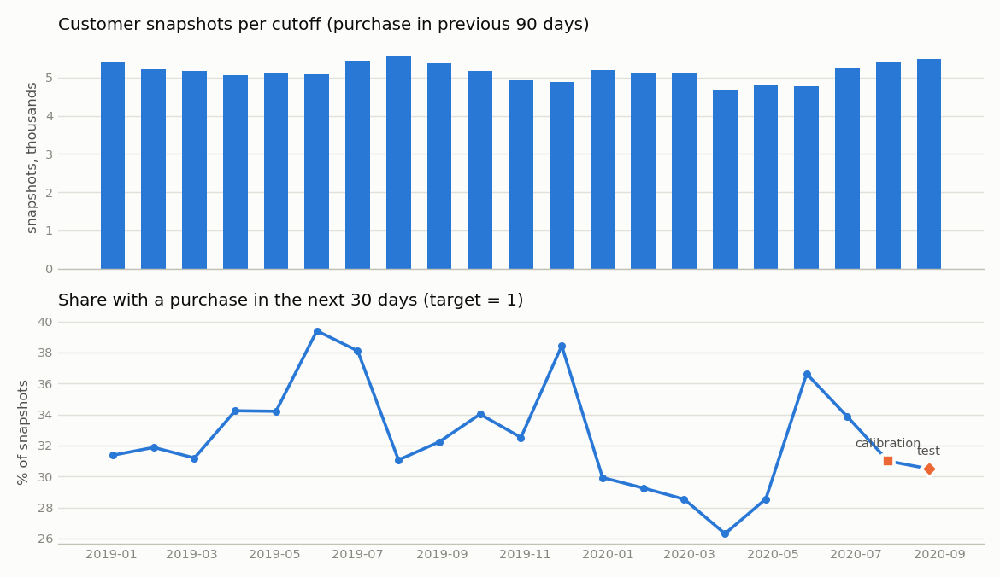
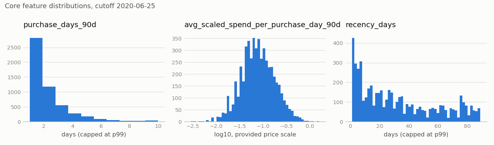
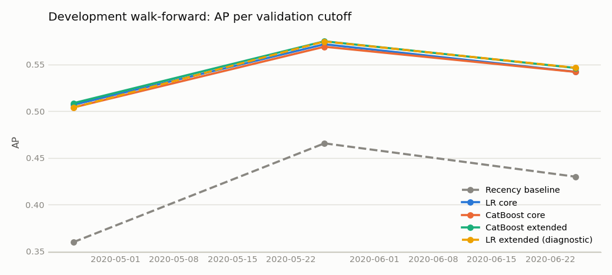
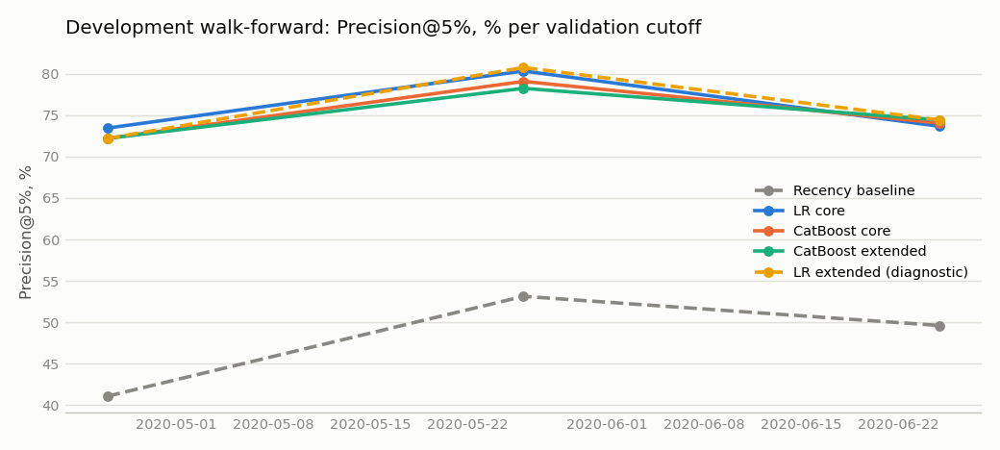
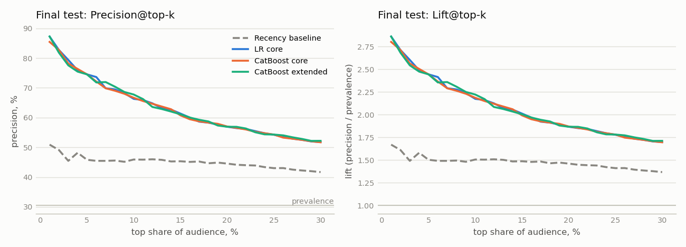
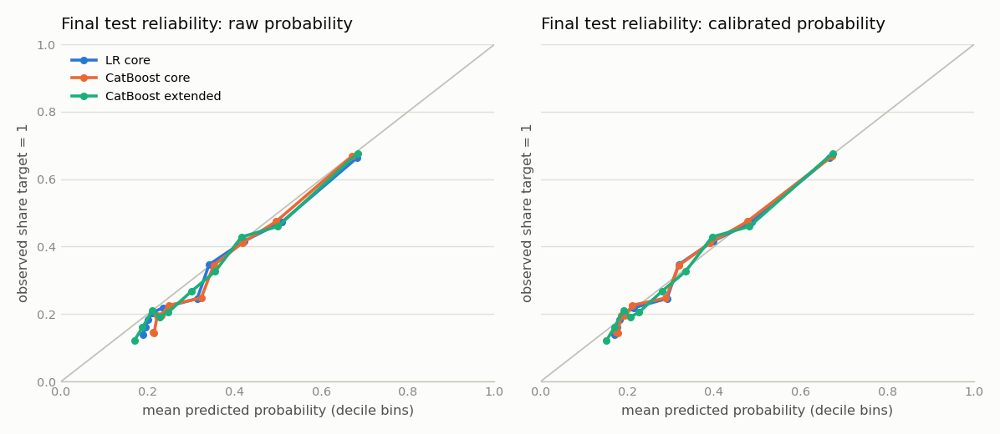
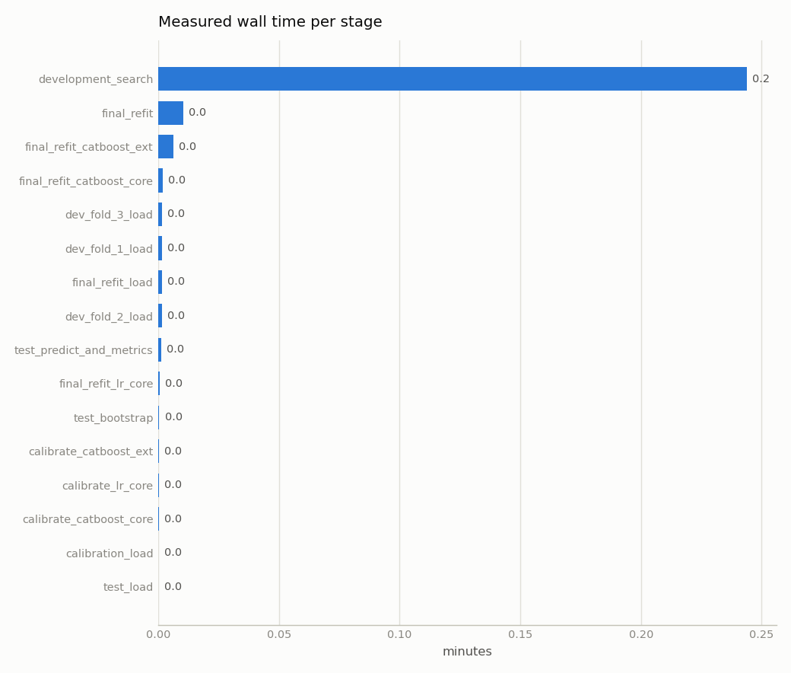

# Результаты: режим `smoke`, run `smoke-20261031T150445Z-f124ab`

Сгенерировано командой `hmrp report` из артефактов run (2026-10-31T15:59:31Z). Набор данных `smoke_dfa33f484c`. Машинно-читаемые файлы: [`runs/smoke-20261031T150445Z-f124ab/`](runs/smoke-20261031T150445Z-f124ab/).

## Данные и когорта

| Величина | Значение |
|---|---|
| Товарные записи transactions_train.csv | 31 788 324 |
| Уникальные customer_id в транзакциях | 1 362 281 |
| Уникальные article_id в транзакциях | 104 547 |
| Диапазон t_dat | 2018-09-20 … 2020-09-22 (734 дат) |
| Строки customers.csv / articles.csv | 1 371 980 / 105 542 |
| Клиенты в наборе `smoke_dfa33f484c` (доля 0.01) | 13 935 |
| Клиенты с ≥1 покупательским днём / с ≥2 | 13 831 / 9 249 |
| Строки customer_day | 90 334 |
| Клиентские срезы (все допустимые cutoff) | 108 226 |
| observation_end_exclusive | 2020-09-23 (max(t_dat) + 1 day: no missing dates and the last day is not truncated) |

## Временные границы

| Этап | Train-срезы (cutoff) | N train | Доля target=1 train | Оценочный срез и окна | N оценки | Доля target=1 |
|---|---|---|---|---|---|---|
| dev fold 1 | 2019-01-02 … 2020-03-27 (16 срезов) | 82 531 | 32.69% | 2020-04-26 → [2020-04-26, 2020-05-26) | 4 812 | 28.55% |
| dev fold 2 | 2019-01-02 … 2020-04-26 (17 срезов) | 87 343 | 32.46% | 2020-05-26 → [2020-05-26, 2020-06-25) | 4 762 | 36.62% |
| dev fold 3 | 2019-01-02 … 2020-05-26 (18 срезов) | 92 105 | 32.67% | 2020-06-25 → [2020-06-25, 2020-07-25) | 5 231 | 33.86% |
| calibration | refit: 2019-01-02 … 2020-06-25 (19 срезов) | 97 336 | 32.74% | 2020-07-25 → [2020-07-25, 2020-08-24); история [2020-04-26, 2020-07-25) | 5 404 | 31.00% |
| final test | те же модели | — | — | 2020-08-24 → [2020-08-24, 2020-09-23); история [2020-05-26, 2020-08-24) | 5 486 | 30.50% |

## Development walk-forward (validation)

Для каждой модели показана конфигурация с лучшим mean AP; все конфигурации — в [`dev_results.csv`](runs/smoke-20261031T150445Z-f124ab/dev_results.csv).

| Модель | Роль | Конфигурация | AP по fold 1/2/3 | mean AP | std AP | mean ROC-AUC | mean Precision@5% |
|---|---|---|---|---|---|---|---|
| recency_baseline | baseline | score=-recency_days | 0.3598 / 0.4656 / 0.4299 | 0.4184 | 0.0538 | 0.6102 | 47.95% |
| lr_core | кандидат | C=1 | 0.5069 / 0.5717 / 0.5422 | 0.5403 | 0.0325 | 0.6752 | 75.81% |
| catboost_core | кандидат | d6_lr0.10_l2_3 | 0.5041 / 0.5691 / 0.5421 | 0.5384 | 0.0327 | 0.6740 | 75.11% |
| catboost_ext | кандидат | d6_lr0.10_l2_3 | 0.5086 / 0.5749 / 0.5463 | 0.5433 | 0.0332 | 0.6826 | 74.96% |
| lr_ext | диагностика | C=1 | 0.5040 / 0.5747 / 0.5465 | 0.5417 | 0.0356 | 0.6798 | 75.79% |

## Выбор модели до final test

- Правило: mean_AP >= max_AP - 0.005 (boundary included); приоритет простоты: lr_core → catboost_core → catboost_ext.
- max mean AP среди кандидатов: 0.5433; near_best: lr_core, catboost_core, catboost_ext.
- **Выбрана: `lr_core`** (конфигурация `C=1`), решение зафиксировано 2026-10-31T15:05:00Z в [`selection_decision.json`](runs/smoke-20261031T150445Z-f124ab/selection_decision.json).

## Калибровка

Platt-калибровка на срезе 2020-07-25 (target [2020-07-25, 2020-08-24), N = 5 404, prevalence 31.00%); p = sigmoid(a·raw_score + b), базовые модели заморожены.

| Модель | Статус | a | b | Основная вероятность |
|---|---|---|---|---|
| lr_core | ok | 1.0186 | -0.0923 | calibrated_probability |
| catboost_core | ok | 1.1197 | -0.0749 | calibrated_probability |
| catboost_ext | ok | 1.0331 | -0.0742 | calibrated_probability |

## Final test

Final test: cutoff 2020-08-24, target [2020-08-24, 2020-09-23), N = 5 486 клиентов, positives = 1 673, бюджет top 5%: k = ceil(0.05·N) = 275. Run `smoke-20261031T150445Z-f124ab`.

| Модель | N | Prevalence | AP | ROC-AUC | P@1% | P@5% | P@10% | Lift@5% | Brier raw | Brier calibrated | LogLoss raw | LogLoss calibrated |
|---|---|---|---|---|---|---|---|---|---|---|---|---|
| recency_baseline | 5 486 | 30.50% | 0.4068 | 0.6350 | 50.91% | 45.82% | 45.90% | 1.502 | — | — | — | — |
| **lr_core** | 5 486 | 30.50% | 0.5374 | 0.7039 | 87.27% | 74.55% | 66.30% | 2.444 | 0.1863 | 0.1857 | 0.5565 | 0.5548 |
| catboost_core | 5 486 | 30.50% | 0.5359 | 0.7041 | 85.45% | 74.55% | 66.67% | 2.444 | 0.1871 | 0.1858 | 0.5588 | 0.5550 |
| catboost_ext | 5 486 | 30.50% | 0.5373 | 0.7064 | 87.27% | 74.55% | 67.76% | 2.444 | 0.1856 | 0.1850 | 0.5546 | 0.5530 |

Ранжирующие метрики (AP, ROC-AUC, Precision/Lift) считаются по `raw_score`; Brier/LogLoss — по вероятностям; у baseline вероятности нет (not_applicable).

## Bootstrap-интервалы

Парный bootstrap по клиентам: 50 из 50 ресэмплов (пропущено с одним классом: 0), seed 7, 95% percentile-интервалы. Интервал не учитывает неопределённость будущего временного сдвига.

| Разность | ΔAP [95% ДИ] | ΔROC-AUC [95% ДИ] | ΔPrecision@5% [95% ДИ] | Отн. изменение P@5% |
|---|---|---|---|---|
| lr_core − recency_baseline | 0.1306 [0.1120; 0.1531] | 0.0689 [0.0561; 0.0835] | +28.73 п.п. [+23.15; +35.03] | +62.7% |
| lr_core − catboost_core | 0.0016 [-0.0009; 0.0045] | -0.0002 [-0.0018; 0.0015] | +0.00 п.п. [-1.45; +2.38] | +0.0% |

## Batch scoring

| as_of_date | Модель | N | k (top 5%) | Основная вероятность | Окно target наблюдаемо | Выгрузка |
|---|---|---|---|---|---|---|
| 2020-08-24 | smoke-20261031T150445Z-f124ab/lr_core | 5 486 | 275 | calibrated_probability | да | `artifacts/runs/smoke-20261031T150445Z-f124ab/scoring/scores_lr_core_asof_2020-08-24.csv` (локально) |
| 2020-09-23 | smoke-20261031T150445Z-f124ab/lr_core | 5 204 | 261 | calibrated_probability | нет (будущее неизвестно) | `artifacts/runs/smoke-20261031T150445Z-f124ab/scoring/scores_lr_core_asof_2020-09-23.csv` (локально) |

## Графики

